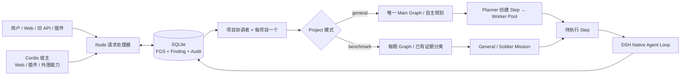

# RedTrace

RedTrace 是一个面向授权安全研究、代码审计与复杂技术调查的本地 Agent 系统。Node 内核把目标、事实、待执行步骤和成果组织为 Graph 隔离的 FGS，再把工作分配给声明了各自模型、资格与并发上限的 Worker。

RedTrace 关注的不是一次对话能否给出答案，而是一个长任务能否被并行推进、持续校正、失败恢复并完整审计。每次执行都有明确输入、结构化输出、运行记录和 Workspace；新的可靠结论会进入共享证据面，供正在运行的其他 Worker 在关键决策点增量获取。

> RedTrace 仅用于获得明确授权的安全测试、研究、竞赛和实验环境。项目提供执行与审计基础设施，不代表对任何目标的访问授权。

## 核心能力

- **原生逆向插件**：执行 Worker 按需加载 REA Skill 并通过原生 Shell 使用 CLI；不注册 REA MCP 工具。管理端停用撤销 Skill，不取消 Step。Commander / 纯 Planner 不获取分析能力。见 [REA 集成说明](docs/rea-integration.md)。

- **Project Commander 闭环**：Benchmark Commander / General Planner 各自拥有项目 Session / STATE / Board / 收件箱；多个项目协调者 与 Worker 共享原有容量并发运行，按所属项目事件唤醒。
- **双模式 FGS**：General 项目一张主图，Benchmark 每题一张独立图；`Fact` 保存有来源的事实，`Goal` 保存完成条件和子目标，`Step` 保存行动与状态，`Finding` 保存可交付成果。`Hint` 与 `Observation` 保持人工输入和中间记录语义。
- **异构 Worker 协同（Worker 即路由）**：任意数量 Worker 各自声明 Provider、模型、模式角色资格（Benchmark：commander/general/soldier；General：planner/worker）、并发与优先级。调度器按资格、容量、优先级与负载公平性选择 Worker，并用该 Worker 的模型配置创建任务——路由完全由 Worker 派生，而非按任务类型写死。
- **Node 24 Agent 运行时**：DSH 原生 Agent Loop 是唯一真实模型执行器；`dsh-llm-pi-ai` 仅适配模型协议。FGS 调度器与 Cordis 插件保持单实例、原生生命周期。
- **运行中知识同步**：证据图谱修订会通过 `agent.inject()` 增量送达正在运行的 Agent；不随执行上下文推送资源清单；按权限查询所需资源。
- **上下文与证据**：按 DSH 当前请求的原生 Token Meter 测量压力，85% 提醒保存 STATE，原生自动压缩后以新 Run/Session 接力；不使用累计 Token 代替压力。Worker 的 Spill/文件证据按哈希保留；Commander 只读项目级证据，不读取任意宿主路径。
- **DSH 原生执行工具链**：Execute Worker 直接获得 DSH 原生能力——`web_search` / `web_fetch`、后台任务（`job_output` / `job_list` / `job_kill`，bash `run_in_background`）、持久 PTY 终端、`glob` / `grep`、工具超时与重复调用防护；LSP 代码导航与 `run_code` 程序化调用按需开启。全部在插件管理页热启停，仅对新会话生效，不自研重复 Skill/MCP。
- **资源与操作面**：统一管理 WebShell、C2 Listener、Session、Payload、凭证、外部插件和操作结果；MSF、Sliver、Cobalt Strike 与自定义 C2 通过同一个 Adapter 合约接入。Resource 保留可变运行状态，不会隐式生成 Fact。
- **可观测与可恢复**：任务、会话、工具事件、输出、心跳、超时、取消和资源操作均可审计，Token 用量按运行累计汇总；Server 或运行时重启后可以恢复未完成状态。
- **Web 控制台与插件接入**：内置证据图谱可视化、运行记录、Workspace、Skill 与 MCP 管理、Worker 设置、插件管理页，并提供浏览器扩展、Burp Suite 和兼容插件 API。

## 工作方式

系统分为三层：**内核**是 TypeScript + Node 24 + 内置 SQLite，负责 FGS、事务、调度、审计与配置；**执行面**按 Worker 路由模型，由 DSH 原生 Agent Loop 执行，并保持 Step 独立会话；**能力层**由 Cordis 插件、Skill、MCP、Resource、浏览器与安全工具组成，按任务装载。



一次典型任务会经历：

1. 用户创建 Project，必须选择 benchmark 或 general，提供 Scope、任务目标与可选 Hint；创建后模式固定。
2. 所属 Commander / Planner 读取自己的 Board、STATE 和增量。Benchmark 固定角色为 Commander、General、Soldier。Scout 已退役；没有既有证据分类的题目保持未分配，不改派其他角色补齐。General 只使用 Planner、Worker：Planner 独占唯一主 FGS、任务级 TodoList、Step 创建、调度和验收；Worker 从 Frontier 原子领取可执行 Step，写回 Fact / Finding。第一项 Step 同样由 Planner 创建，不自动启动 Bootstrap 或报告 Worker。Benchmark 发现漏洞不再自动启动 Reporter；General 的报告是 Worker 的可选交付能力，由 Planner 按需决定，优先复用产生 Finding 的 Worker / 原 Session，仅在上下文不可用或明确需要独立整理时安排额外 Soldier Step。
3. Benchmark 简单题由 Soldier 自主规划和执行；困难题或升级后由唯一 General 进入 ARTEX Planner 模式，只规划、调度和分析证据，Specialist 继承 Soldier 执行工具，每次执行一个 Step。General 项目模式仍只调度现有 Worker Pool。调度器按模式角色资格、模型路线与既有全局/项目/Worker 配额原子领取 Step，DSH 在独立 Run / Session / Agent Workspace 执行；历史 Workspace 不搬移。
4. Worker 通过 Fact/Finding 共享确认结论，HELP/REPORT 经原生收件箱实际交付；queued 不代表已入模。Planner / Benchmark 单题规划者对证据验收，不把消息或 Step 结束当成果。
5. Stop/同 Session 恢复、任务 Park 与新 Run 接力分别建模。只有原执行停止、工具结果明确后才能恢复或换模型；未知操作不自动重放。
6. General Planner 通过确认 Fact/Finding 验收 Goal，Benchmark 仍由单题规划者验收题目 Goal；Family Transfer 只生成未验证 Hint，目标必须复验。没有独立 Reason 调度器；两模式共享同一 DSH 执行内核。

本次架构、数据迁移、API 和使用方法参见历史 [Project Commander 升级说明](docs/project-commander-20261113/GUIDE.md)。历史迁移记录见 [Legion 实施记录](docs/legion-implementation-20261110/IMPLEMENTATION.md)。历史调度设计不再代表独立 Reason 的执行决策。题目级 General 的事件循环、Fact 验收与统一额度语义见 [ARTEX Planner 迁移](docs/artex-planner-20261117.md)。

## 为什么选择 RedTrace

### 从“对话历史”转向“可验证证据”

模型对话适合思考，但不适合作为多人协同的唯一状态。RedTrace 将可复用结论写入证据图谱，把待验证方向单独建模，并保留每条结果的任务、会话和审计来源。后续 Worker 可以从稳定的共享事实继续工作，而不必反复重读完整对话。

### 并行而不失控

调度同时约束全局并发、活动项目数、单项目并发和单 Worker 配额。任务派发还会考虑 Worker 能力、健康状态、优先级、当前负载和失败冷却窗口，从而让多个模型与多个项目共享资源时保持可预测性。

### 长任务中的实时协同

正在运行的 Worker 不必等到下一次任务启动才看到新证据。RedTrace 会监视证据修订，通过运行时的原生注入通道发送精简更新；完整内容继续按需读取，避免无边界地扩张 Prompt。

### 一个内核，一个 Agent 执行器

FGS Store 负责唯一持久状态，Scheduler 只领取 Step 和分配配额，DSH 负责模型会话与工具；Pi Agent 已退役，`dsh-llm-pi-ai` 只负责模型协议，不运行 Agent；旧 API、Cordis 插件和外围能力都调用同一组 Node 存储函数。

可编辑配置保存后热加载：工具启停与固定角色绑定在下一模型步骤及新调用生效，不取消进行中的调用；Worker / Provider / Model 路线在新 Run 或下一协调轮次采用。common_env 会刷新现有会话的 Web 密钥；MCP 配置变更自动重连，Skill 内容与启停复用 DSH 文件监听。更新源代码后的首次进程加载与配置热加载不同。

## 快速开始

### 环境要求

- Node.js 24.15 或更高版本，且保持在 Node 24 LTS 主版本
- npm（仅首次安装锁定的 Node 依赖时使用）
- 一个 OpenAI 兼容或 Anthropic 兼容的模型 API 端点与密钥

Windows、macOS 和 Linux 均可原生运行，无需 Docker 与 WSL。

### 一键部署（Linux / macOS / WSL）

```bash
git clone https://github.com/0X6C7879/RedTrace.git
cd RedTrace
bash deploy.sh
```

`deploy.sh` 会检测 Linux 或 macOS，准备 Node、Playwright/Chromium、共享 Skill 和可选安全工具链。Linux 支持 APT、DNF/YUM、Pacman、Zypper 与 APK；也可以只检查安全工具链计划：

```bash
bash install-security-toolchain.sh --dry-run apt
```

### 一键启动（Windows / macOS / Linux）

Windows 先在 PowerShell 中复制配置，然后可双击 `start-redtrace.cmd`，也可在终端启动：

```powershell
Copy-Item redtrace.local.example.yaml redtrace.yaml
.\start-redtrace.cmd
```

macOS、Linux 或 WSL：

```bash
cp redtrace.local.example.yaml redtrace.yaml
./start-redtrace.sh
```

复制后编辑 `redtrace.yaml`：填入 `providers.<name>.api_key`，按需调整 `workers`。两个入口首次运行会执行锁定的 npm 安装并构建 Cordis 兼容运行时，之后直接启动。默认监听 `127.0.0.1:8000`；本机访问 `http://127.0.0.1:8000`。DSH 不接受通配监听地址；如需局域网访问，使用 `--host <本机局域网 IP>`。它们接受 `--config`、`--host` 和 `--port`；旧 `--compat` 参数仅兼容接受，不再切换执行器。`Ctrl+C` 会停止本次 Node 进程。用户调用的 Python 安全工具仍可作为外部工具使用，RedTrace 自身不依赖 Python。

### 运行时模型

启动后只有一个 Node 进程：Cordis Web 服务直接调用 Node 请求处理器并提供 Web UI（默认监听 `127.0.0.1:8000`），没有 FastAPI 反代。`mock` Worker 走进程内确定性执行器，用于开发、持久化测试和性能对照。

Worker 声明逻辑路由：每个 Worker 独立声明 `provider`、`model`、`roles` 中的模式角色资格（`commander/general/soldier` 或 `planner/worker`，可同时选择）、`max_running` 并发与 `priority`；调度器按资格、容量、优先级与负载公平性选择 Worker，并用该 Worker 的模型配置创建任务。同一 Worker 可同时承担两种模式的角色，不需要复制；Provider、Model、并发和优先级不变。旧资格保留 Benchmark；Commander→Planner，General / Soldier→Worker。上一轮 Leader / Operator 资格合并为 Worker，历史配置若还含 `scout`，需先删除该角色及对应配置；不会自动转授资格。Worker 修改后对新任务自动生效，无需重启——设置页与直改配置文件都走同一条热加载链路，任何配置变更都不要求重启进程。

#### 工具与调用统计

工具按五个固定角色绑定，不绑定 Worker 或动态 Agent。启用状态与角色绑定同时控制下一模型步骤及新调用，不取消进行中的调用；Commander 可读写项目证据/交接文档并查询 Worker 原始输出，但不获得 Shell 或 REA 执行权限；Planner 对齐 ARTEX 的文件、Bash、Skill 和可用 Web 基础工具。DSH 原生 Schema 与执行实现不改，原生工具同样支持角色绑定、启停热加载；新模型步骤和新调用生效，不取消进行中的调用。REA 优先通过 PATH 中的 `rea` CLI 和按需 Skill 使用，仅保留无等价 CLI 的共享 Program / Hopper / Evidence MCP 操作。

工具页只展示真实 Schema（含已停用项），区分 DSH / RedTrace / MCP；不计 CLI、Skill 或历史工具。全局目录与活动 Run 当前模型可见数量分别统计。「调用统计」打开后才查询原 SQLite 审计，用 `run_id + call_id` 合并开始/完成事件，支持 Project、模式、固定角色和时间筛选；未完成调用不算失败，汇总不受历史分页影响。实现与验收见 [角色与工具系统](docs/role-tool-system.md)。

#### 同模型供应商轮询与故障切换

参考 ARTEX 的供应商池和首输出前故障转移设计：在设置页新增多个 Provider，分别填写自己的协议、地址和密钥，并给它们添加**完全相同的模型 ID**，即可自动组成轮询池；不需要重复创建 Worker。不同模型 ID 不会混用，单供应商保持原行为。

在**运行设置 → Provider 模型服务 → 轮询配置**中，可以开关轮询、按模型勾选供应商，并用上下箭头调整顺序；保存后通过原有配置热加载生效。只有一家参与时不轮询，关闭时始终使用 Worker 指定的 Provider。未勾选 Worker 指定的供应商时，该 Worker 保持直连。设置持久化在 `llm_polling.enabled` 和 `llm_polling.models.<模型 ID>`（供应商名称数组）中；旧配置默认保持开启和自动分组。

每次模型请求轮换起点（手动设置顺序后首次从列表第一家开始，否则首次从 Worker 指定的 Provider 开始），故障时按配置顺序继续尝试同 ID 的其他 Provider，每个请求最多尝试每家一次。支持 OpenAI Completions、Responses 和 Anthropic Messages 混合供应商；同 ID 必须指向同一个模型，并配置兼容的上下文、输出上限和 reasoning 能力，请求参数不会为切换而降级。

- 仅在尚未输出内容时，对鉴权/余额不足、404、408、429、5xx、网络及连接超时等供应商故障切换。400、上下文超限、调用取消，以及已经输出文本、思考或工具调用的流不会重放；全部失败时保留最后一家供应商的原始错误。
- Worker 并发配额、任务会话和权限不变；没有全局锁、排队、额外退避或持久化熔断。故障供应商仍会在后续轮次被尝试，轮询游标在配置热加载/重启后重置。
- 连接测试只检查选中的供应商，避免备用供应商掩盖错误配置。会话记录中的 `llm/polling` / `llm/polling-failed` 标记实际调用及切换失败；Worker/助手消息的 provider 仍表示逻辑路由，跨供应商的私有重放状态不复用，失败尝试已报告的 token 用量计入合计。

Agent 继承启动用户的宿主机权限；isolated 执行 profile 可按 Intent 启用沙箱。请只在已隔离且获得授权的环境中使用。

### Docker Compose 模式

```bash
cp redtrace.local.example.yaml redtrace.yaml
docker compose up --build
```

Compose 会构建单进程 Node 服务。Node 容器直接运行 FGS 调度器、Cordis Web 宿主与执行器，并挂载共享能力目录、运行数据目录和项目 Workspace。

如需使用其他配置文件：

```bash
REDTRACE_CONFIG_FILE=./redtrace.mock.example.yaml docker compose up --build
```

启动完成后访问 <http://127.0.0.1:8000>。容器入口与健康检查复用同一个具体 IPv4 接口地址，保留 DSH 禁止通配监听的限制；Compose 默认仅向宿主机回环地址发布 8000 端口。

### Mock 模式

Mock Worker 只执行显式 Soldier Mission，用于协议与调度回归；不会冒充 Commander 规划或验收，不调用外部模型：

```bash
cp redtrace.mock.example.yaml redtrace.yaml
./start-redtrace.sh --config redtrace.yaml --mock
# Windows: start-redtrace.cmd --config redtrace.yaml --mock
```

## 配置概览

两个可直接复制的配置模板：

| 文件 | 用途 |
|---|---|
| `redtrace.local.example.yaml` | 宿主机直跑 Worker |
| `redtrace.mock.example.yaml` | 无外部模型的开发和自动化测试 |

关键配置域：

| 配置域 | 说明 |
|---|---|
| `providers` | API 协议（OpenAI/Anthropic 兼容）、endpoint、密钥与模型列表（context window、max tokens、reasoning 策略） |
| `workers` | 模型路由、启用状态、任务资格、优先级和并发 |
| `runtime` | 全局/项目并发限制 |
| `tasks` | 各角色的主阶段与收尾超时、通用模式 Max Step、Benchmark 最大题目并发 |

`tasks.commander.max_intents` 是通用模式主 FGS 的最大活跃 Step（Max Step）；`tasks.commander.max_benchmark_tasks` 是 Benchmark 同时推进的题目数上限，未配置则不限制。Benchmark 每题仍按原有加人策略增加 Step，不受 Max Step 限制。两项均可在设置页保存后热加载：有足够独立、可执行工作时规划者补足目标，前置条件未满足或方向不足时不重复凑数；降低上限不终止在途任务，后续派发仍受 Worker、项目和全局容量约束。
| `common_env` | 传递给 Worker 的环境变量 |

配置支持快照与热加载：新任务使用新配置，已经运行的任务继续使用启动时快照。Web 设置页可创建、复制、启停和测试 Worker；写入使用 revision 做乐观并发控制，API Key 不会在查询响应中回显。

运行数据只写当前项目：`.redtrace/` 保存数据库、日志、锁和共享运行时，`workspaces/<project_id>/` 保存 Worker 会话、提示与工件，`output/webshell/` 和 `output/c2/` 保存人工审计需要长期保留的落地结果。删除工作台任务会删除对应 Workspace 和任务对话，并物理压缩数据库；WebShell/C2 资产及其操作记录继续保留。

## 常用命令

### 主程序

```bash
./start-redtrace.sh --config redtrace.yaml --port 8000
# Windows: start-redtrace.cmd --config redtrace.yaml --port 8000
```

### DSH 运行时构建与测试

```bash
npm run dsh:install        # 安装 vendored DSH 运行时依赖
npm run dsh:update         # 更新到上游最新发布版本（包含 RC），保留本地补丁并构建验证
npm run dsh:build          # 构建上游 + RedTrace DSH 扩展包
npm run dsh:test           # 运行 TypeScript 侧测试
```

Web 控制台的「设置 → DSH 运行时」提供检查更新和更新按钮。更新使用上游发布版本（包含预发布版），保留 `scripts/dsh-local.patch` 中的定制补丁；先在独立目录安装、构建并通过测试和启动检查，再替换运行时。Web 更新要求 Worker 空闲，成功后暂停新任务，重启 RedTrace 才会生效。失败保留当前版本，成功时旧版本备份在 `.redtrace/dsh-updates/`。直接修改过 DSH 源码时会拒绝覆盖，需先将改动维护到补丁中。独立运行目录（如 WSL 源码与运行时分离）请通过命令更新后重新部署。

### 共享资源与能力动词

资源（WebShell、C2 Listener/Session/Payload、凭证、流量伪装 Profile、代理、文件）由引擎统一登记，人机共用。Web UI 的运维页提供全量管理与审批；Worker 侧通过工具访问：通用的 `resource_register` / `resource_list` / `resource_get`（`resource_register` 支持 secret 存储但不回显），以及 WebShell / C2 通道族的富表单工具（`webshell_register`、`c2_listener_create`、`c2_session_create`、`c2_credential_create`、`c2_profile_create`、payload 生成；会话查询复用 `resource_list` / `resource_get`）。执行 Worker 在任务中建立的通道、凭证与 payload 都会出现在对应运维页面上。

执行 Worker 自主使用已启用的能力工具，不由 Commander 通过 Step `requires/plugins` 预先授权。派发器按当前 Project 资源选择通道（target 主机匹配或 `via` 显式指定），缺少验证缓存时复用轻量探测，不把未记录验证等同于工具不可用。真实连接、资源暂停、适配器支持和有状态通道串行仍须满足。`GET /capabilities/verbs` 提供管理视图；Worker 的 Resource、任务、结果与审计按 Project 隔离。自建 Browser 已删除，保留 Playwright request API 的独立 HTTP 工具，不引进 DSH 浏览器。

MSF、Sliver、Cobalt Strike 与自定义 C2 通过同一个 Adapter 合约接入：RedTrace 轮询 `GET /sessions?framework=...`，向 `POST /execute` 发送会话动作，并向 `POST /payloads` 请求原生 Payload。Adapter 返回的会话自动进入全局 C2 会话页。

## 仓库结构

| 路径 | 内容 |
|---|---|
| `packages/redtrace-engine/` | Node FGS 存储、Commander 与四角色调度、REST/SSE、配置、审计与外围能力 |
| `packages/redtrace-dsh/` | 引擎宿主的 Cordis 适配插件包：插件管理、资源工具、执行工具链、审计投影与引擎调度器生命周期 |
| `vendor/deepseek-harness/` | DSH/Cordis 运行时（vendored，通过设置页或 dsh:update 手动更新） |
| `profiles/redtrace/` | Cordis 运行时组装配置（node 单入口） |
| `static/` | Web UI 静态资源（HTML/JS/CSS/字体/图表库） |
| `skills/` | 多 Worker 共享的一级原生 Skill；由 Agent 按需直接加载 |
| `mcp/` | 共享 MCP 配置与服务入口 |
| `container/` | Worker 容器镜像与运行资产 |
| `scripts/` | 构建、启动与基准辅助脚本 |
| `.github/workflows/` | 三平台 CI（dsh-mainline） |
| `.redtrace/` | 项目级数据库、日志、锁和内部运行状态（不提交） |
| `workspaces/` | 按任务隔离的 Worker 会话、提示、临时文件和工件（不提交） |
| `output/webshell/`、`output/c2/` | 供人工审计的 WebShell/C2 落地文件（不提交） |
| `docs/` | 协议、架构和上下文文档 |

## 验证与测试

```bash
npm ci --prefix packages/redtrace-engine
npm run --prefix packages/redtrace-engine check
npm test --prefix packages/redtrace-engine
npm run dsh:test
docker compose config -q
```

Node 测试覆盖 FGS 事务、并发领取、事实触发规划、暂停恢复、旧 API 投影、配置密钥、外围能力、Cordis 生命周期、启动脚本和 Mock 端到端流程；DSH 扩展继续用 `node:test` 覆盖插件与旧 Agent 钩子。

CI 在 Windows、macOS 与 Ubuntu 三个平台上运行 Node 24.21：内核类型检查与测试 → DSH 构建、测试与探针 → 启动脚本冒烟。

## 安全边界

- 默认执行继承启动用户的宿主机权限，没有额外沙箱；isolated 执行 profile 可按 Intent 启用进程与文件系统沙箱。
- Container 模式提供项目级文件与进程边界，但网络能力和 Linux capabilities 仍应按最小权限配置。
- 对外监听 Server 时，应配置访问令牌并限制网络暴露。
- API Key 与其他敏感配置应通过 RedTrace 的密钥存储或环境变量提供，不要提交到仓库。
- WebShell 和 C2 操作只应指向明确授权的目标；高风险动作建议启用人工审批。

## 进一步阅读

- [Node FGS 运行时](docs/specs/node-fgs-runtime.md)
- [Capability Registry(动词能力体系)](docs/specs/capability-registry.md)
- [Server 协议](docs/specs/server-protocol.md)
- [Context Harness](docs/specs/context-harness.md)

## 许可证

本项目基于 **GNU AGPLv3** 许可证发布。商业授权请联系项目维护者。
