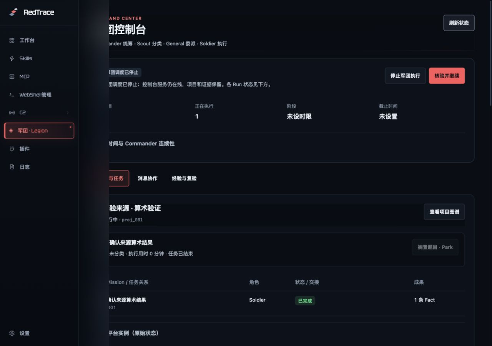
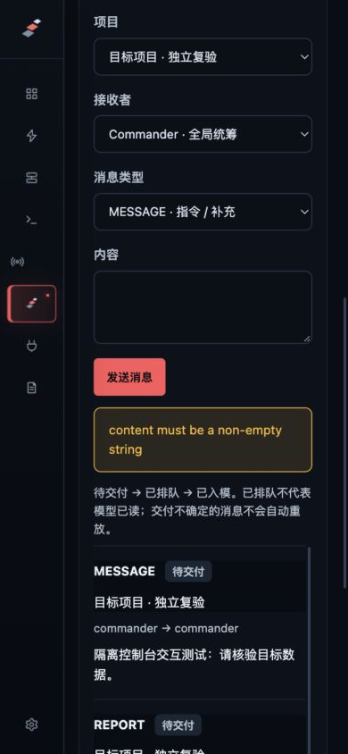
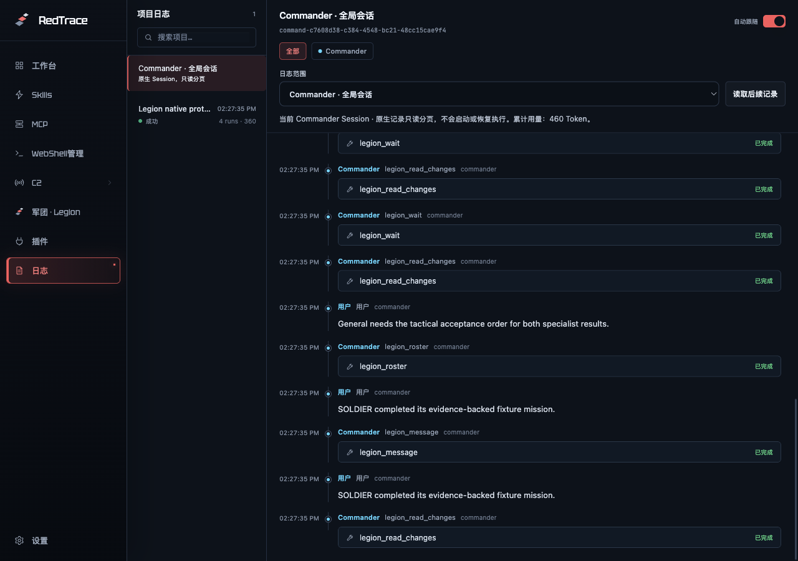
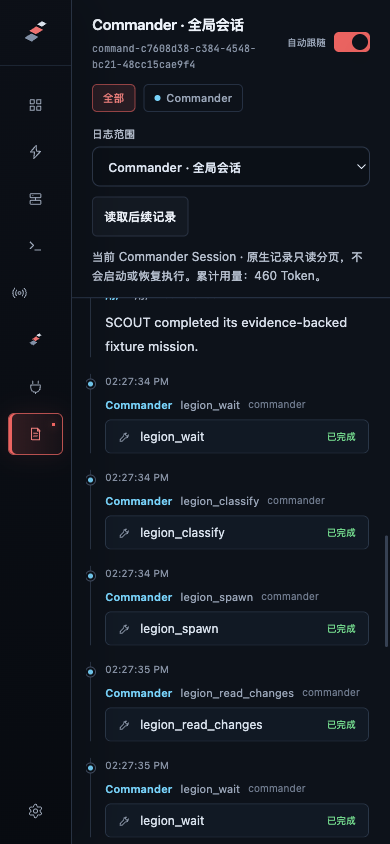
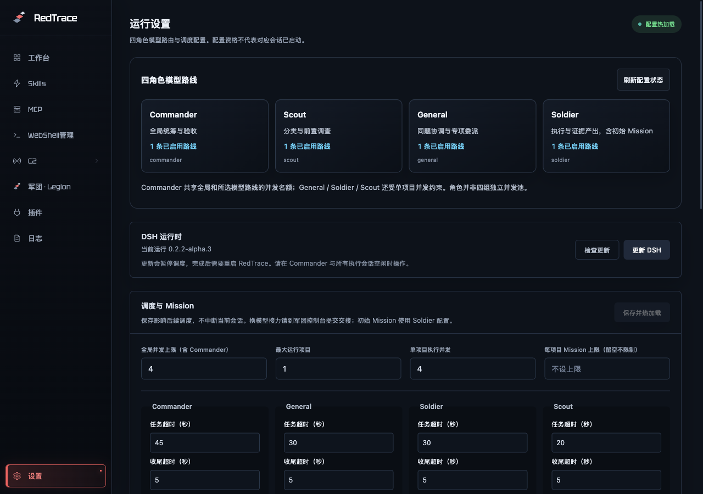
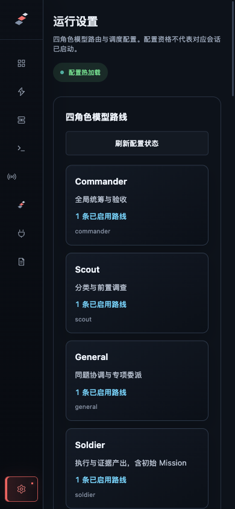
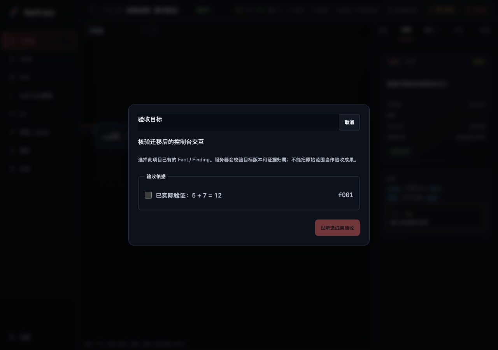
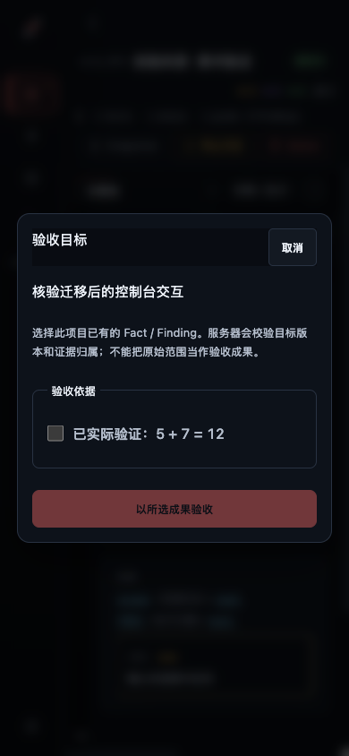
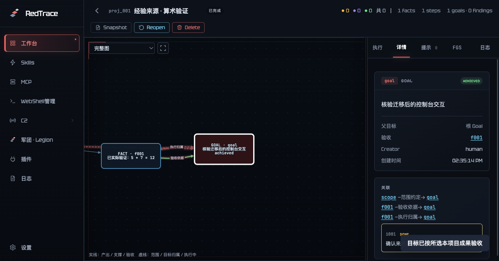

# RedTrace 军团迁移：前端控制台收尾验收

日期：2026-11-12。对象：/Users/lxy/Downloads/RedTrace。

## 结论与边界

本地 E0–E7 源码迁移与本地切换已有记录；本批补齐军团、工作台/FGS、日志、设置的前端联动。不是只改军团页皮肤。累计 95 个变更文件的归档与补丁已重建验证。本批源码变更 14 个文件（12 个修改、2 个新增）。

此前指定 auto/deepseek-flash 的真实四角色和 Family Transfer 复验证据仍保留于 /Users/lxy/Downloads/RedTrace/docs/legion-implementation-20261110/E3-E7/real-model-evidence-1794381174959/result.json。本批最终改动跑过原生 DSH 本地协议闭环和真实 HTTP/UI 交互，**没有再跑指定外部模型，也不声称外部比赛平台/VPN/授权目标验收已完成**。

E7 当时最终宿主停止是历史结果。今天最终只读观察到另一个终端启动的主宿主 PID 59469 在线；GET /v2/legion 为 200，Campaign=stopped、projects=[]，GET /v2/projects=[]。当前 Commander 未创建 Session，日志接口 200、available=false。未重启、停止这个既有宿主，未调用正式 resume/执行/清理接口。不能再用“当前无宿主进程”描述现状。本批所有写入验收只发生在隔离夹具，已回收夹具进程。

## 实际完成

### 军团与工作台
- 分开呈现 Campaign 调度状态、宿主在线状态、Mission 和 Run 状态；Park 不再冒充 paused，unknown 明确待核验。
- Park 恢复、同角色模型交接、消息和目标复验使用原生 dialog 与实际选项，替代要求用户填写原始 ID 的 prompt。关闭回到触发按钮。
- 收件人只来自本项目合适的真实执行会话；模型只来自已启用同角色路线。交接请求已保存不等于旧执行已停止或新 Run 已启动。
- 消息 pending/queued/admitted/uncertain 分开显示，入队不冒充已读，不冒充 Fact。
- Family Transfer 仅为未验证 Hint；目标确认只选目标任务自身 Fact。证据显示 SHA、已读字节和剩余分页；缺失、二进制与读取错误明确显示。
- 工作台统一 Mission 术语，Soldier 初始 Mission 保留原内部字段。FGS 详情显示 role/taskKey/父 Mission/Park 阻塞和恢复条件/STATE/前序 Run/交接状态。
- 人工验收 Goal 使用捕获的项目证据列表和版本，拒绝时保留选择；实际 UI 验收将来源项目 goal 改为 achieved、evidenceIds=[f001]、version=2，另一目标项目 goal 仍为 open、version=1。

### 日志
- Commander 全局原生 Session 与 General/Soldier/Scout 项目日志分开；项目计数不混入 Commander 累计用量，累计 Token 不称为上下文压力。
- 新增只读 GET /v2/legion/session/events，固定当前 Campaign Session，不接收任意 Session/路径，不创建或恢复执行。复用原生 read 所有权、有界分页和事件投影。真正丢失的已创建 Session 报 404，未创建状态明确 available=false。
- 修复历史时间被读取时间替换的问题：投影读取原生 event.time；支持当前 DSH system/message。重复读取原生历史时间一致。
- 项目支持角色/Worker/Run 筛选和实时连接说明；失败、暂停、取消、未知状态不再统一绿色已完成。保留证据可按需有界读取。
- Store 的 Run 状态通知复用既有提交后微任务流；Run 行是持久真值，不增加审计持久行或新的 DB 查询。避免真实结束后日志不刷新。

### 设置与视觉交互
- 四角色实际可用路线、启用情况和共享容量清楚展示；mock Commander 路线不冒充可启动 DSH。
- 使用后端有效超时默认值；未配置 max_intents 保持空，不伪造限制。配置未加载完成前不提供可保存的假默认控件。
- 原生配置 revision 冲突 409 后草稿保留；取消丢弃保留草稿，明确放弃后重载实际配置；实际保存成功有回执。
- 说明配置影响后续调度、现有会话换模型走交接、DSH 更新需要 Commander 和 Worker 空闲。
- 延续原深色 RedTrace 身份，操作正文系统字体、四角色颜色、响应式表单/时间线、原生 dialog 焦点、减少动态效果/透明度与高对比偏好。未引入前端框架或依赖。

## 浏览器验收

内置浏览器先完成军团及设置功能分支，后连接持续超时。用户明确允许 ego-browser 后，使用同一 TaskSpace 1 补齐最终验收；TaskSpace 已正常 finish。截图均来自实际本地页面，不是设计图；数据注明为隔离夹具。

- 军团：消息 pending 保存、服务器拒绝空消息保留草稿；Park→pending；交接请求保存仍保留旧 running Run；源经验→未验证 Hint→目标 Fact 确认；10872/10872 字节证据完整读取；Escape 关闭和焦点返回；390px 无横向溢出。
- 设置：隔离服务真实 revision 409，草稿 maxWorkers=5 保留；取消丢弃仍为 5；明确重载读取 maxWorkers=4/maxProjects=2；随后 UI 保存为 5/2。原有 4 个成功 Run 未改变。
- 日志：实际原生 DSH Commander Session 只读历史和 system prompt，Run 选择 General 后只显示对应 General/用户日志；Commander 全局切换成功。最终 390px 页面宽 390，JS error/unhandledrejection=[]。
- 设置：390px 页面宽 390、设置容器 scrollWidth=clientWidth=311。
- 目标验收 dialog：390px 页面宽 390、dialog scrollWidth=clientWidth=350。提交后 dialog 关闭、真实 Goal 状态和证据关系更新、另一项目未变，JS errors=[]。

截图：

**军团桌面**（07-overview-desktop.png）

**军团窄屏错误保留**（09-mobile-server-error.png）

**Commander 桌面日志**（14-commander-native-desktop.png）

**Commander 390px**（15-commander-mobile.png）

**设置桌面**（17-settings-desktop.png）

**设置 390px**（16-settings-mobile.png）

**目标证据选择**（18-goal-evidence-desktop.png）

**目标证据选择 390px**（19-goal-evidence-mobile.png）

**实际验收结果**（20-goal-accepted.png）

（图片与本报告同目录，即 /Users/lxy/Downloads/RedTrace/docs/legion-implementation-20261110/frontend-console-20261111/。）

## 测试与回滚

- 类型检查退出 0；DSH 构建退出 0。
- Engine 264 项：259 通过、4 失败、1 跳过，退出 1。四项均为原有离线知识库 Python ENOENT，未跳过/隐藏。
- DSH 59 项：58 通过、0 失败、1 跳过，退出 0。
- FGS + 控制台定向 29 项全部通过。本批控制台专项 21 项。
- 原生 DSH：四角色、两个专项 Worker、共享 FGS、Commander 验收、真实消息入模、STATE/游标、同 Session 恢复和原生 Commander 日志读取通过；模型为 local-protocol-fixture，不是指定外部模型。
- 全迁移 BASELINE：LEGION_SUPPORTED=false / LEGION_RUNTIME_SUPPORTED=false，退出 0。
- 全迁移 MODIFIED：General/Park/恢复和四角色原生闭环为 true，退出 0。
- 全迁移 ROLLBACK：两个标志恢复 false，退出 0；406 个原件哈希完全恢复，新增文件移除。
- 本批前端 BASELINE：raw-id/prompt、failed→已完成、unknown→运行中，无原生 Commander 读取/保留证据读取/配置冲突草稿保留。
- 本批 MODIFIED：select/dialog、failed→失败、unknown→结果待核验，原生读取/证据读取/草稿保留均为 true。
- 本批 ROLLBACK：恢复与 BASELINE 完全相同 stdout；13 个原件哈希相同、2 个新增文件移除。三个角色匹配命令均退出 0、stderr 为空。原工作区始终保留修改后内容。
- 累计 95 文件补丁重建与归档重开哈希一致。源码回滚只在独立副本执行，不是正式数据库备份；恢复源码后运行前需重建 DSH。

失败和更正均保留：旧测试对既有提交后微任务流错误假设同步、FGS VM 未加载新 helper/父字段 null 绑定、一次测试文件名不存在、浏览器 stale ref/不匹配 selector 与旧 viewport 截图均已纠正并重新核验。git diff --check 相对 HEAD 报原有 config.ts:117 尾随空格（本批基线原样存在）；针对本批 before 的逐文件 --check 无空白诊断，退出 1 表示文件有差异。

## 修改文件

- /Users/lxy/Downloads/RedTrace/static/index.html
- /Users/lxy/Downloads/RedTrace/packages/redtrace-engine/src/legion-store.ts
- /Users/lxy/Downloads/RedTrace/packages/redtrace-engine/src/config.ts
- /Users/lxy/Downloads/RedTrace/static/audit.js
- /Users/lxy/Downloads/RedTrace/packages/redtrace-engine/compat/legion.mjs
- /Users/lxy/Downloads/RedTrace/packages/redtrace-engine/compat/cordis.mjs
- /Users/lxy/Downloads/RedTrace/packages/redtrace-engine/test/legion-runtime.fixture.mjs
- /Users/lxy/Downloads/RedTrace/packages/redtrace-engine/src/store.ts
- /Users/lxy/Downloads/RedTrace/packages/redtrace-dsh/src/types.ts
- /Users/lxy/Downloads/RedTrace/packages/redtrace-dsh/src/audit.ts
- /Users/lxy/Downloads/RedTrace/packages/redtrace-dsh/test/event-projection.test.mjs
- /Users/lxy/Downloads/RedTrace/packages/redtrace-engine/test/fgs.test.ts
- /Users/lxy/Downloads/RedTrace/static/legion.css
- /Users/lxy/Downloads/RedTrace/packages/redtrace-engine/test/legion-console.test.ts

static/audit.css 曾纳入基线核对但本批未改。文档、探针和回执在本目录补充，不替代原四角色交付。

## 控制、权限与性能

未新增额外控制机制（锁、队列、自动重试、fallback 或依赖）。仅将既有同角色/范围/版本/未知结果校验正确映射到 UI；读取接口沿用参数边界、原生所有权和认证链。提交中/快照加载中的 UI 禁用状态避免假操作，不改变执行器调度。

Board 从单一 running 查询改为 running/paused/unknown 三次既有索引查询，以呈现真实未结束状态；不扫描全量终态历史。Commander 历史/Fact/证据按需读取，无新增轮询计时器。既有 SSE 与合并刷新继续复用；专项并行、配额、权限与隔离未变。日志后端和投影改动是正确呈现最新状态所必需，非另起执行系统。

## 四件交付物及使用边界

1. /Users/lxy/Downloads/RedTrace/docs/legion-implementation-20261110/MODIFIED_FILE.tar.gz
2. /Users/lxy/Downloads/RedTrace/docs/legion-implementation-20261110/DIFF_FILE.patch
3. /Users/lxy/Downloads/RedTrace/docs/legion-implementation-20261110/VERIFICATION.txt
4. /Users/lxy/Downloads/RedTrace/docs/legion-implementation-20261110/ROLLBACK.sh

全迁移副本回滚：ROLLBACK.sh TARGET_COPY；依赖同目录 BASELINE.tar.gz、BASELINE-EXTRA.tar.gz。
仅本批前端副本回滚：ROLLBACK.sh TARGET_COPY --frontend；依赖同目录 FRONTEND-BASELINE.tar.gz。
切勿在原仓库盲目执行。实际运行数据备份仍为 E7-cutover 中原有独立备份。

未验收：外部比赛平台/VPN/授权目标，4 项离线 Python 失败，可选 Ghidra。未在本批最终源码上再跑指定外部模型；未对既有正式宿主执行重启或恢复。宿主在线不等于军团正在执行。
